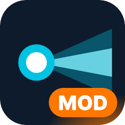
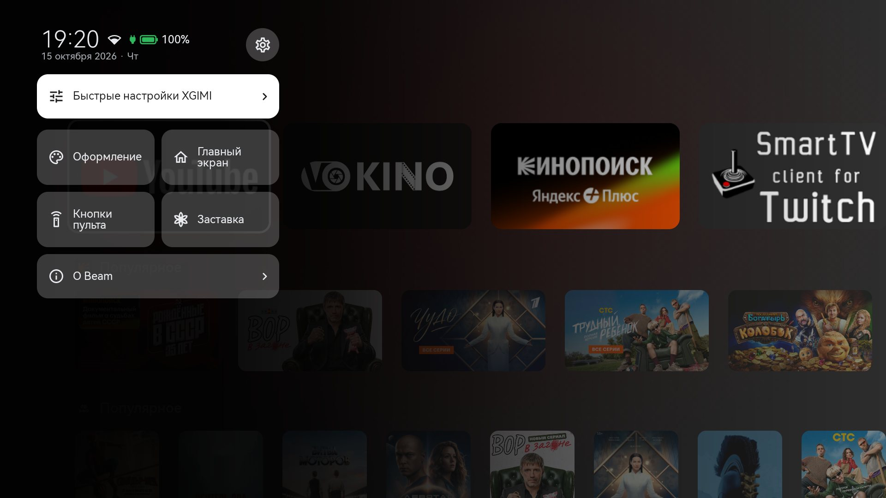
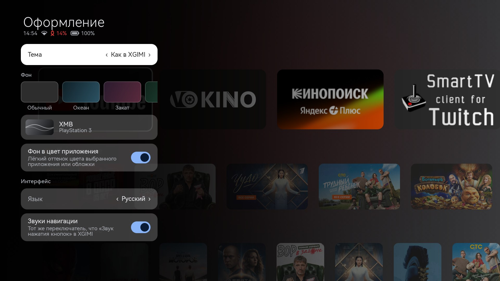
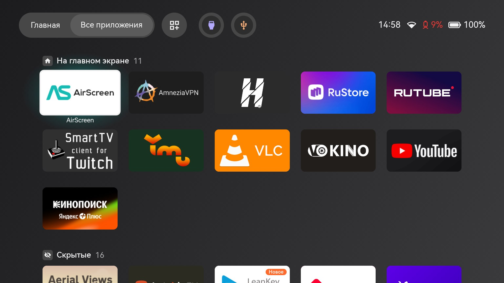
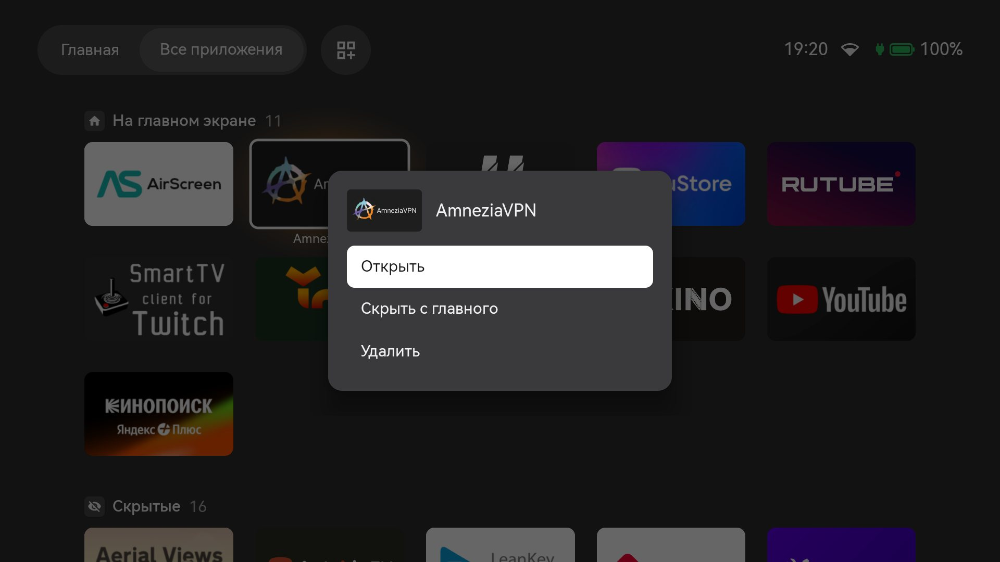

<p align="center"></p>

# Beam Mod

Домашний экран для проектора **XGIMI Play 6** (Android 11) на Jetpack Compose. Заменяет стоковую
оболочку XGIMI с китайскими сервисами и рекламой. Прошивку не трогает: всё ставится и откатывается
через adb. Интерфейс на русском и английском. [English version](README.en.md)

> Неофициальный проект, никак не связанный с XGIMI. Сделан и проверен только на XGIMI Play 6.

Модификация лаунчера [Beam](https://github.com/tonisaf/beam-launcher) (автор — tonisaf) от **Dobrein**. Версия и авторы — в самом лаунчере: настройки → «О Beam Mod».

## Что умеет

**Главный экран**

- Ряд плиток 16:9 в вашем порядке: зажать OK → «Переместить», ◀ ▶, OK. Там же «Скрыть» и «Удалить».
- Верхняя строка как на Google TV: вкладки «Главная» и «Все приложения», кнопка настроек, часы,
  Wi-Fi, VPN, батарея.
- Подключённые флешки и HDMI — «пилюлями» сверху, с именем устройства («PlayStation 5 · HDMI 1»).
- Ряды каналов других приложений (SmartTube, VoKino, Кинопоиск, «Продолжить просмотр»): включаются,
  убираются и переставляются в «Настроить ряды».
- Выбор как на Google TV: белая рамка и ореол в цвет приложения; фон тоже окрашивается в его цвет.
- «Сейчас играет», плавная загрузка с заглушками, кадр 9–11 мс вместо 14–18.

**Все приложения** — разделы «На главном экране» и «Скрытые», системные в одной плитке, метка
«Новое» на свежеустановленных.

**Батарея** — заряд проектора и стенда XGIMI вместе, оставшееся время сразу (учится на реальном
расходе), предупреждения на 15% и 5% поверх любого приложения.

**Оформление**

- Тема следует за «Стиль темы» XGIMI (и за «Авто»), светлая — в цветах XGIMI. Можно закрепить свою.
- Фоны карточками, меняются сразу при выборе; анимированный фон в стиле PS3 XMB.
- Звуки навигации — тот же переключатель, что «Звук нажатия кнопок» в XGIMI.
- Язык интерфейса выбирается в Beam Mod: прошивка не принимает английский как системный.

**Настройки** — страница в стиле быстрой панели XGIMI, поверх любого приложения по голосовой кнопке
пульта: оформление, главный экран, заставка (XGIMI или Aerial Views), «О Beam Mod».
Оттуда же — панель и настройки XGIMI; открыта всегда только одна из панелей.

**Кнопки пульта** — четыре кнопки китайских видеосервисов назначаются на любое приложение или действие:
в настройках XGIMI → Общие → «Кнопки пульта» (модуль tonisaf, ставит установщик).

**Обновления** — «О Beam Mod» раз в день проверяет релизы этой сборки, сверяет SHA-256, подпись и
версию и передаёт APK установщику Android (код перенесён из Beam 1.0.1).

## Отличия от Beam 1.0.1 (tonisaf)

Сборка основана на Beam 0.3. Дальше tonisaf сделал из Beam универсальный лаунчер для любых
Android TV и убрал из него всё, что связано с XGIMI; эта сборка, наоборот, развивает версию для
XGIMI Play 6.

| | Beam 1.0.1 | Эта сборка |
|---|---|---|
| Интерфейс | универсальный, под любой Android TV | переработан под XGIMI Play 6: выбор и переходы как на Google TV, меню по зажатию OK, «Все приложения» по разделам |
| Шрифты и поведение | — | единая шкала шрифтов; везде одна логика: зажать OK — меню, стрелки — переместить, OK — готово, Назад — отмена |
| Скорость | — | кадр главного экрана 9–11 мс вместо 14–18, обложки и фон рисуются заранее, меньше памяти |
| Устройства | любой Android 8+ | только XGIMI Play 6 |
| Главный экран | раскладки «Плитки» и «Google TV» | плитки 16:9 под верхней строкой Google TV |
| HDMI и USB | плитки в ряду приложений | «пилюли» в верхней строке, с именем устройства |
| Порядок плиток и рядов каналов | есть | есть, плюс «Настроить ряды» с обложками |
| Батарея | заряд | заряд стенда и проектора, время работы, предупреждения |
| Тема и звуки | свои; звуки UISFX | вслед за XGIMI; системные звуки |
| Фон | свои фоны и своя картинка | фоны карточками, фон в цвет приложения |
| Панель настроек | удалена | в стиле XGIMI, поверх приложений |

**Переход с оригинального Beam.** Эта сборка подписана другим ключом и поверх оригинала не
ставится. Скрипт установки сам вернёт стоковый лаунчер, удалит старый Beam и его заглушки кнопок
и поставит эту сборку; настройки Beam Mod начнутся заново.

## Скриншоты

| Главный экран | Панель настроек Beam Mod |
|---|---|
|  |  |

| Оформление | Перемещение плитки |
|---|---|
|  |  |

| Все приложения | Меню по зажатию OK |
|---|---|
|  |  |

## Установка

Понадобятся компьютер с Windows 10 или 11, флешка и проектор в той же Wi-Fi-сети, что и компьютер.
Около 15 минут, с русификацией меню XGIMI — около 30. Подходит и для нового проектора из коробки.

### Шаг 1. Включить ADB на проекторе

В стоковых настройках ADB нет, его включает приложение SystemUI Tuner:

1. Скачайте `SystemUITuner_…-release.apk` из [github.com/zacharee/Tweaker/releases](https://github.com/zacharee/Tweaker/releases).
2. Переименуйте файл, добавив в конец `.1` (получится `…-release.apk.1`): иначе файловый менеджер
   проектора его не откроет. Если расширений не видно: Проводник → *Вид* → *Показать* →
   *Расширения имён файлов*. Скопируйте файл на флешку (FAT32) и вставьте её в проектор.
3. На проекторе: приложения → файловый менеджер → файл на флешке → OK → последний пункт
   («Другие действия») → установщик APK → «Открыть один раз» → установить → «Открыть».
4. В SystemUI Tuner пролистайте приветствие, найдите пункт ADB и включите его. Надпись, что
   отладка по Wi-Fi не поддерживается, можно не замечать: по сети всё равно работает.
5. Узнайте IP проектора: Настройки → Сеть → Wi-Fi → текущая сеть. Чтобы адрес не менялся,
   закрепите его в настройках роутера.

### Шаг 2. Запустить установщик

1. Скачайте `BeamMod-Setup-….zip` из [последнего релиза](https://github.com/DobreinGitHub/beam-launcher-mod/releases/latest)
   и распакуйте (правой кнопкой → «Извлечь всё»). Выключите VPN на компьютере.
2. Запустите **«Установить.cmd»**. Если Windows покажет «Система Windows защитила ваш компьютер»:
   «Подробнее» → «Выполнить в любом случае».
3. Введите IP проектора. На проекторе появится запрос отладки: отметьте «Всегда разрешать» и нажмите OK.
4. Ответьте на вопросы, у каждого есть короткое пояснение; Enter — ответ по умолчанию:
   - **русифицировать меню XGIMI** — перевод настроек и панели XGIMI
     ([xgimi-play6-russifier](https://github.com/tonisaf/xgimi-play6-russifier) от tonisaf). На
     новом проекторе — да. Если перевод уже стоит, вопроса не будет;
   - **модуль кнопок пульта** — четыре кнопки китайских сервисов назначаются в настройках XGIMI →
     Общие → «Кнопки пульта» (модуль из комплекта русификатора, по умолчанию да);
   - **заставка [Aerial Views](https://github.com/theothernt/AerialViews)** — 4K-видео вместо
     заставки XGIMI (стороннее приложение, по умолчанию нет);
   - **не закрывать фоновые приложения** — прошивка перестанет закрывать VPN и музыку при
     переключении приложений (по умолчанию да);
   - **часовой пояс** — по умолчанию Europe/Moscow.
5. Дождитесь «Всё готово». Проектор сам перезагрузится несколько раз: не выключайте его и не закрывайте
   окно. В конце он загрузится в Beam Mod.

Установщик сам скачает adb (если его нет), русификатор (около 190 МБ) и клавиатуру LeanKey и
проверит их по SHA-256. Beam Mod уже лежит в архиве. Что меняется на
проекторе — [ниже](#что-меняет-restoreps1). Запускать можно повторно: сделанное не испортится.

### Шаг 3. Проверить

Нажмите «Домой»: должен открываться Beam Mod. Голосовая кнопка пульта открывает настройки Beam Mod,
кнопка настроек — панель XGIMI. Четыре кнопки приложений на пульте назначаются в настройках XGIMI →
Общие → «Кнопки пульта».

### Если что-то не работает

- **Проектор не отвечает:** проектор и компьютер в одной сети, VPN выключен, IP верный. После сна
  проектора ADB иногда выключается: включите его снова в SystemUI Tuner, установщик подождёт.
- **Русификатор пишет, что прошивка не поддерживается:** он работает только с прошивкой v1.7.116.
  Beam Mod поставится и без него.
- **Русификация оборвалась:** установщик всё равно поставит Beam Mod. Довести перевод: `XgimiInstaller.exe`
  в папке русификатора (её путь установщик пишет в конце; обычно `russifier` рядом с ним или
  `C:\Users\Public\Beam\russifier`) → «Дополнительно» → «Завершить настройку». Эту папку не удаляйте:
  из неё работает удаление перевода.
- **Строки `[!!]`:** запустите «Установить.cmd» ещё раз; если повторяется — пришлите вывод окна.

### Установка вручную (`restore.ps1`)

Для тех, кто ставит из исходников или хочет всё контролировать. Нужен adb
([Platform Tools](https://developer.android.com/tools/releases/platform-tools)); русификатор ставится
отдельно своим установщиком (отметьте только перевод: его лаунчер BEAM — это оригинальный Beam, не эта сборка).
В PowerShell из папки репозитория:

```powershell
powershell -ExecutionPolicy Bypass -File .\tools\restore.ps1 -Device 192.168.1.50 -Adb C:\adb\adb.exe -Reboot
```

`192.168.1.50` замените на IP проектора. Параметры:

- `-TimeZone Europe/Kyiv`, `-Locale`, `-BluetoothName "Своё имя"` — вместо Europe/Moscow, ru-RU и
  «XGIMI Play 6»; `-SkipSystem` — не трогать эти три настройки. Английский как язык системы прошивка
  не принимает: язык Beam Mod выбирается в самом Beam Mod.
- `-AerialViews` — заставка Aerial Views (версия 1.8.5, проверяется по SHA-256); `-KeepBackgroundApps` —
  не закрывать фоновые приложения (`persist.xgimi.restrictbackground.enable`, после перезагрузки).
- APK Beam Mod берётся из сборки, из `tools\apks\` или `-Apk`, иначе скачивается из релиза и проверяется
  по `SHA256SUMS.txt` (`-Release v0.2` — другой релиз, `-NoDownload` — без скачивания). Другие APK для
  установки заодно (LeanKey, SmartTube…) положите в `tools\apks\`.
- IP и путь к adb можно один раз вписать в `local.env` (`DEVICE=…`, `ADB=…`).
- У каждого шага в выводе `[OK]`; `[!!]` — ошибка.

### Что меняет `restore.ps1`

Прочитайте до запуска:

- устанавливает Beam Mod и удаляет заглушки кнопок пульта прежних версий (кнопки теперь назначает модуль
  tonisaf; настоящие приложения с теми же именами пакетов остаются);
- **отключает** (`pm disable-user`, без удаления) стоковый лаунчер `com.xgimi.home`, клавиатуру
  Sogou, рекламу, телеметрию, отправку отчётов, китайский магазин, голосовые и IoT-сервисы XGIMI.
  Полный список в скрипте, раздел 2. Стоковый лаунчер отключается только после того, как Beam Mod
  установлен и назначен домашним экраном;
- делает LeanKey системной клавиатурой, если она установлена;
- выдаёт Beam Mod права через adb: статистика использования, доступ к уведомлениям (для «Сейчас
  играет»), каналы ТВ, `WRITE_SECURE_SETTINGS`,
  изменение системных настроек;
- включает службу специальных возможностей Beam Mod (добавляет её к уже включённым): она ловит
  голосовую кнопку и рисует панель поверх приложений. Прошивка сбрасывает её при загрузке, Beam Mod включает её обратно сам;
- делает Beam Mod домашним экраном;
- ставит русский язык, часовой пояс **Europe/Moscow** и Bluetooth-имя «XGIMI Play 6». Другое
  задают параметры `-Locale`, `-TimeZone`, `-BluetoothName` (или `LOCALE`, `TIMEZONE`, `BT_NAME` в
  `local.env`), а `-SkipSystem` не трогает эти три настройки.
- по желанию: `-AerialViews` ставит и включает заставку Aerial Views, `-KeepBackgroundApps`
  отключает закрытие фоновых приложений прошивкой (`persist.xgimi.restrictbackground.enable`).

### Откат

```powershell
.\tools\restore.ps1 -Device 192.168.1.50 -Revert        # IP свой; добавьте -Reboot, чтобы перезагрузить
```

Скрипт включает всё, что отключил (стоковый лаунчер первым), возвращает системную клавиатуру,
убирает Beam Mod из служб специальных возможностей (остальные остаются), а затем удаляет сам Beam Mod (и заглушки кнопок пульта прежних версий, если остались). Русификатор и модуль
кнопок пульта остаются: у них своё удаление в установщике русификатора. Если стоковый лаунчер включить не удалось, Beam Mod не удаляется, чтобы не
остаться без домашнего экрана. Язык, часовой пояс и Bluetooth-имя назад не меняются: прежние
значения неизвестны. Заставка возвращается на XGIMI (Aerial Views остаётся
установленной), закрытие фоновых приложений прошивкой включается обратно. Если установлен Projectivy, он тоже снова включается, и при первом нажатии
«Домой» система может спросить, какой лаунчер использовать.

Вручную то же самое:

```sh
adb shell pm enable com.xgimi.home          # и остальные пакеты из раздела 2 restore.ps1
adb uninstall com.home.tiles
```

После перезагрузки домашним экраном снова будет стоковый лаунчер.

## Вопросы и ответы

**Можно просто поставить APK, без скрипта?** Он установится и запустится, но домашним экраном не
станет (стоковый лаунчер XGIMI остаётся включённым), а без выданных скриптом прав не заработают
панель по голосовой кнопке после перезагрузки, «Сейчас играет», ряды с каналами, начальный
порядок плиток и время заставки.

**Панель не открывается по голосовой кнопке.** Проверьте, что включена служба специальных
возможностей «Beam Mod: панель». Скрипт её включает, прошивка сбрасывает её при загрузке, Beam Mod
возвращает её при запуске. Без прав из скрипта (`WRITE_SECURE_SETTINGS`) это не получится.

**Английский интерфейс?** «Оформление» → «Язык». Системный язык этого проектора на английский
переключить нельзя (прошивка не принимает), поэтому язык выбирается в самом Beam Mod.

**Работает на других моделях XGIMI?** Не проверялось: лаунчер откроется, но функции проектора
(яркость, трапеция, фокус, батарея) могут не работать.

**Как вернуть всё как было?** [Откат](#откат): `restore.ps1 -Revert`.

**Что с приватностью?** Рекламы и аналитики нет, исходный код открыт. Доступ в сеть нужен для
картинок каналов других приложений и проверки обновлений Beam Mod.

## Сборка

Нужны JDK 17 и Android SDK (путь в `ANDROID_HOME` или `local.properties`).

```sh
./gradlew :app:assembleRelease
```

APK появится в `app/build/outputs/apk/release/`.

### Подпись

Релизы подписаны постоянным ключом, он лежит вне репозитория. Благодаря этому новую версию можно
ставить поверх старой (`adb install -r`, настройки сохраняются). Gradle берёт ключ из
`~/.beam/release.properties` (или из файла, путь к которому в `BEAM_RELEASE_PROPS`):

```properties
storeFile=C:/Users/you/.beam/beam-release.jks
storePassword=...
keyAlias=beam
keyPassword=...
```

Ключ создаётся один раз: `keytool -genkeypair -alias beam -keyalg RSA -keysize 4096 -validity 36500
-keystore beam-release.jks`. Храните копию: потерянный ключ значит, что у всех придётся удалить Beam Mod и
поставить заново. Без этого файла (например, в CI) сборка подписывается debug-ключом компьютера:
она ставится, но не обновит Beam Mod, подписанный настоящим ключом, и наоборот. Отпечаток SHA-256
сертификата релизов этой сборки: `DC:F7:75:50:94:E8:9D:D1:41:7F:2C:17:00:B1:F1:B0:7E:06:13:B3:07:60:5E:09:C0:AB:07:96:EC:33:09:67` (у оригинального Beam другой ключ).

### Быстрая установка при разработке

```sh
cp local.env.example local.env   # впишите IP проектора (и пути, если adb не в PATH)
./deploy.sh                      # собрать и поставить Beam Mod
./deploy.sh --no-start           # не выводить Beam Mod на экран после установки
```

`local.env` в git не попадает. Его читают и `deploy.sh`, и `tools/restore.ps1`.

### Как Beam Mod управляет проектором

Какие сервисы, классы и настройки прошивки XGIMI вызывает Beam Mod и что в ней не работает так, как
ожидается: [docs/xgimi-firmware.md](docs/xgimi-firmware.md).

### Команды для отладки

```sh
adb shell am broadcast -n com.home.tiles/.AdbCommandReceiver --es background XMB --ez bg_animation true
adb shell am broadcast -n com.home.tiles/.AdbCommandReceiver --ez ambient_tint false   # фон в цвет приложения
adb shell am broadcast -n com.home.tiles/.AdbCommandReceiver --es bt_name "XGIMI Play 6"
```

## Лицензия

[MIT](LICENSE). Проект распространяется «как есть», без гарантий: `restore.ps1` меняет системные
настройки проектора, запускайте его на свой риск.
